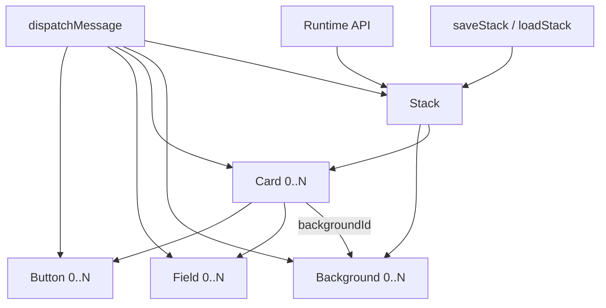
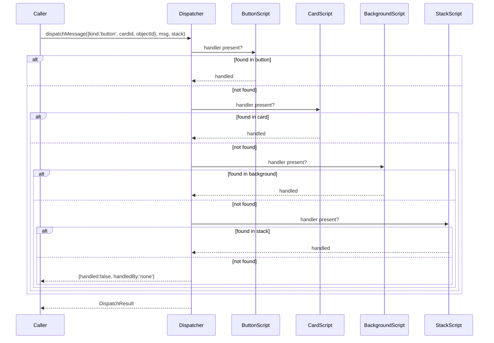
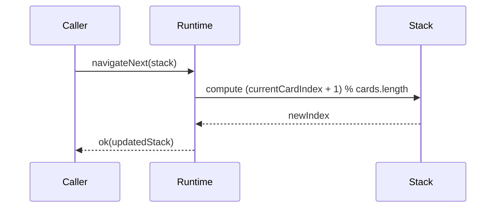

# Design Document: Stack Model

## Overview

The stack model is the core data layer for HyperCard Reborn. It defines the TypeScript types for stacks, backgrounds, cards, buttons, and fields; a message-passing system that bubbles HyperTalk messages up the object hierarchy; a runtime API for field access and navigation; and save/load serialisation. All code lives in `src/engine/` with zero React or DOM imports, using the existing `Result<T,E>` / `EngineError` primitives from `result.ts`.

The design follows an immutable data approach: mutating operations (field text, navigation) return a new `Stack` value rather than modifying in place, keeping the runtime safe for use in a React-driven UI that relies on referential equality for change detection.

## Architecture



## Sequence Diagrams

### Message Dispatch (Button)



### Navigation



## Components and Interfaces

### Component 1: Data Model Types (`stack-types.ts`)

**Purpose**: Pure TypeScript type definitions for every stack object.

**Interface**:

```typescript
export interface Rect {
  x: number;
  y: number;
  w: number;
  h: number;
}

export interface BackgroundField {
  id: string;
  name: string;
  rect: Rect;
}

export interface Background {
  id: string;
  name: string;
  script?: string;
  fields: BackgroundField[];
}

export interface Button {
  id: string;
  name: string;
  rect: Rect;
  script?: string;
  style: 'default' | 'transparent' | 'checkbox' | 'radio';
}

export interface Field {
  id: string;
  name: string;
  rect: Rect;
  text: string;
  script?: string;
}

export interface Card {
  id: string;
  name: string;
  backgroundId: string;
  script?: string;
  buttons: Button[];
  fields: Field[];
}

export interface StackMetadata {
  createdAt: string;   // ISO 8601
  modifiedAt: string;  // ISO 8601
}

export interface Stack {
  id: string;
  name: string;
  backgrounds: Background[];
  cards: Card[];
  currentCardIndex: number;
  script?: string;
  metadata: StackMetadata;
}
```

**Responsibilities**:
- Provide the canonical shape for all runtime data.
- Keep types free of logic so they can be imported anywhere without side effects.

---

### Component 2: Message Passing (`message.ts`)

**Purpose**: Route HyperTalk messages up the object hierarchy.

**Interface**:

```typescript
export type MessageTarget =
  | { kind: 'button'; cardId: string; objectId: string }
  | { kind: 'field';  cardId: string; objectId: string };

export interface HyperTalkMessage {
  handlerName: string;
  args: string[];
}

export type HandledBy = 'button' | 'card' | 'background' | 'stack' | 'none';

export interface DispatchResult {
  handled: boolean;
  handlerName: string;
  handledBy: HandledBy;
}

export function dispatchMessage(
  target: MessageTarget,
  message: HyperTalkMessage,
  stack: Stack,
): DispatchResult;
```

**Responsibilities**:
- Locate the target object within the stack.
- Walk the bubble chain: object → card → background → stack.
- Use the existing `parser` / `tokenizer` to scan handler names from scripts (or a lightweight regex scan to avoid full parse overhead for dispatch).
- Return `handledBy: 'none'` when no level claims the message.

---

### Component 3: Runtime API (`stack-runtime.ts`)

**Purpose**: Provide the interpreter's `Environment` with typed, immutable operations on a `Stack`.

**Interface**:

```typescript
export function getFieldText(
  stack: Stack,
  cardId: string,
  fieldId: string,
): Result<string, EngineError>;

export function setFieldText(
  stack: Stack,
  cardId: string,
  fieldId: string,
  text: string,
): Result<Stack, EngineError>;

export function currentCard(stack: Stack): Card;

export function navigateTo(
  stack: Stack,
  cardId: string,
): Result<Stack, EngineError>;

export function navigateNext(stack: Stack): Result<Stack, EngineError>;

export function navigatePrev(stack: Stack): Result<Stack, EngineError>;
```

**Responsibilities**:
- All mutation returns a new `Stack`; original is untouched.
- Return `err(...)` for unknown ids, empty stacks, etc.
- `currentCard` is the only non-`Result` function; it assumes a valid, non-empty stack (callers guard this invariant).

---

### Component 4: Serialisation (`stack-serialise.ts`)

**Purpose**: Convert a `Stack` to and from a JSON string with validation.

**Interface**:

```typescript
export function saveStack(stack: Stack): string;

export function loadStack(json: string): Result<Stack, EngineError>;
```

**Responsibilities**:
- `saveStack` uses `JSON.stringify`; stable key order is not required.
- `loadStack` parses with `JSON.parse`, then runs a hand-written structural validator that checks required fields, correct types, and referential integrity (every `card.backgroundId` references an existing background).
- Returns `err(...)` on any schema violation or parse failure.

---

### Component 5: Validator (`stack-validate.ts`)

**Purpose**: Hand-written structural validator reusable by both `loadStack` and any future UI form layer.

**Interface**:

```typescript
export function validateStack(value: unknown): Result<Stack, EngineError>;
export function validateCard(value: unknown): Result<Card, EngineError>;
export function validateBackground(value: unknown): Result<Background, EngineError>;
```

**Responsibilities**:
- Type-narrow `unknown` input to `Stack` using explicit field checks.
- Verify `currentCardIndex` is in bounds.
- Verify every `card.backgroundId` resolves to a background in the stack's `backgrounds` array.
- Return the first validation error encountered with a descriptive message.

---

## Data Models

### Rect

```typescript
interface Rect { x: number; y: number; w: number; h: number; }
```

**Validation Rules**:
- All four fields must be finite integers (no NaN, no Infinity).
- `w` and `h` must be ≥ 0.

### Stack

```typescript
interface Stack {
  id: string;             // non-empty UUID-format string
  name: string;           // non-empty
  backgrounds: Background[];  // length ≥ 0
  cards: Card[];          // length ≥ 1 when in use; may be 0 for a blank new stack
  currentCardIndex: number;   // 0 ≤ index < cards.length (or 0 when cards is empty)
  script?: string;
  metadata: StackMetadata;
}
```

### Card

```typescript
interface Card {
  id: string;
  name: string;
  backgroundId: string;   // must reference a Background.id in the same Stack
  script?: string;
  buttons: Button[];
  fields: Field[];
}
```

### Button / Field

Both share the `Rect` geometry and an optional `script` string. `Button` additionally carries a `style` discriminant.

---

## Algorithmic Pseudocode

### dispatchMessage

```typescript
function dispatchMessage(target, message, stack): DispatchResult {
  // 1. Locate card
  const card = stack.cards.find(c => c.id === target.cardId);
  if (!card) return { handled: false, handlerName: message.handlerName, handledBy: 'none' };

  // 2. Locate object (button or field) on the card
  const objects = target.kind === 'button' ? card.buttons : card.fields;
  const obj = objects.find(o => o.id === target.objectId);
  if (!obj) return { handled: false, handlerName: message.handlerName, handledBy: 'none' };

  // 3. Bubble chain
  if (obj.script && scriptHasHandler(obj.script, message.handlerName)) {
    return { handled: true, handlerName: message.handlerName, handledBy: target.kind };
  }
  if (card.script && scriptHasHandler(card.script, message.handlerName)) {
    return { handled: true, handlerName: message.handlerName, handledBy: 'card' };
  }
  const bg = stack.backgrounds.find(b => b.id === card.backgroundId);
  if (bg?.script && scriptHasHandler(bg.script, message.handlerName)) {
    return { handled: true, handlerName: message.handlerName, handledBy: 'background' };
  }
  if (stack.script && scriptHasHandler(stack.script, message.handlerName)) {
    return { handled: true, handlerName: message.handlerName, handledBy: 'stack' };
  }
  return { handled: false, handlerName: message.handlerName, handledBy: 'none' };
}
```

**Preconditions**:
- `stack` is a valid, non-null `Stack`.
- `message.handlerName` is a non-empty string.

**Postconditions**:
- Result is always a `DispatchResult` (never throws).
- `handled === true` iff `handledBy !== 'none'`.
- `handledBy` is the **first** level in the chain that claimed the message.

**Loop Invariants**: The bubble chain is a fixed 4-step linear sequence; no loop is involved.

---

### navigateNext / navigatePrev

```typescript
function navigateNext(stack): Result<Stack, EngineError> {
  if (stack.cards.length === 0) return err('Stack has no cards');
  const next = (stack.currentCardIndex + 1) % stack.cards.length;
  return ok({ ...stack, currentCardIndex: next });
}

function navigatePrev(stack): Result<Stack, EngineError> {
  if (stack.cards.length === 0) return err('Stack has no cards');
  const prev = (stack.currentCardIndex - 1 + stack.cards.length) % stack.cards.length;
  return ok({ ...stack, currentCardIndex: prev });
}
```

**Preconditions**:
- `stack` is non-null.

**Postconditions**:
- If `cards.length > 0`, result is `ok` and `0 ≤ newIndex < cards.length`.
- Wraps around at both ends.

---

### loadStack validator (structural check)

```typescript
function validateStack(value: unknown): Result<Stack, EngineError> {
  // 1. Must be a plain object
  if (typeof value !== 'object' || value === null || Array.isArray(value))
    return err('Stack must be an object');
  const v = value as Record<string, unknown>;

  // 2. Required string fields
  for (const key of ['id', 'name']) {
    if (typeof v[key] !== 'string' || (v[key] as string).length === 0)
      return err(`Stack.${key} must be a non-empty string`);
  }

  // 3. backgrounds array
  if (!Array.isArray(v.backgrounds)) return err('Stack.backgrounds must be an array');
  const backgrounds = [];
  for (const bg of v.backgrounds) {
    const r = validateBackground(bg);
    if (!r.ok) return r;
    backgrounds.push(r.value);
  }

  // 4. cards array
  if (!Array.isArray(v.cards)) return err('Stack.cards must be an array');
  const bgIds = new Set(backgrounds.map(b => b.id));
  const cards = [];
  for (const card of v.cards) {
    const r = validateCard(card, bgIds);
    if (!r.ok) return r;
    cards.push(r.value);
  }

  // 5. currentCardIndex bounds
  const idx = v.currentCardIndex;
  if (typeof idx !== 'number' || !Number.isInteger(idx) || idx < 0 ||
      (cards.length > 0 && idx >= cards.length))
    return err('Stack.currentCardIndex out of bounds');

  // 6. metadata
  const meta = validateMetadata(v.metadata);
  if (!meta.ok) return meta;

  return ok({ id: v.id as string, name: v.name as string,
               backgrounds, cards, currentCardIndex: idx,
               script: typeof v.script === 'string' ? v.script : undefined,
               metadata: meta.value });
}
```

---

## Key Functions with Formal Specifications

### `getFieldText`

```typescript
function getFieldText(stack: Stack, cardId: string, fieldId: string): Result<string, EngineError>
```

**Preconditions**:
- `stack` is a valid `Stack`.
- `cardId` and `fieldId` are non-empty strings.

**Postconditions**:
- Returns `ok(field.text)` if card and field are found.
- Returns `err(...)` if card does not exist in `stack.cards`.
- Returns `err(...)` if field does not exist in the card's `fields`.
- No mutation of `stack`.

---

### `setFieldText`

```typescript
function setFieldText(stack: Stack, cardId: string, fieldId: string, text: string): Result<Stack, EngineError>
```

**Preconditions**:
- Same as `getFieldText`.
- `text` is any string (including empty).

**Postconditions**:
- Returns `ok(newStack)` where `newStack` is structurally identical to `stack` except the targeted field's `text` equals the provided `text`.
- Returns `err(...)` on unknown ids.
- Original `stack` is unchanged (immutable update).

---

### `navigateTo`

```typescript
function navigateTo(stack: Stack, cardId: string): Result<Stack, EngineError>
```

**Preconditions**:
- `cardId` is a non-empty string.

**Postconditions**:
- Returns `ok(newStack)` where `newStack.currentCardIndex` is the index of the card whose `id === cardId`.
- Returns `err(...)` if no card has that id.

---

## Example Usage

```typescript
import { navigateNext, setFieldText, getFieldText } from './stack-runtime';
import { saveStack, loadStack } from './stack-serialise';
import { dispatchMessage } from './message';

// Build a minimal stack
const stack: Stack = {
  id: 'stack-1',
  name: 'Demo',
  backgrounds: [{ id: 'bg-1', name: 'Main', fields: [] }],
  cards: [
    {
      id: 'card-1',
      name: 'Home',
      backgroundId: 'bg-1',
      buttons: [{ id: 'btn-1', name: 'Go', rect: { x:10, y:10, w:80, h:30 }, style: 'default' }],
      fields:  [{ id: 'fld-1', name: 'Title', rect: { x:10, y:50, w:200, h:20 }, text: 'Hello' }],
    },
  ],
  currentCardIndex: 0,
  metadata: { createdAt: new Date().toISOString(), modifiedAt: new Date().toISOString() },
};

// Navigate
const next = navigateNext(stack);  // wraps: stays on card 0

// Field access
const text = getFieldText(stack, 'card-1', 'fld-1');  // ok('Hello')
const updated = setFieldText(stack, 'card-1', 'fld-1', 'World');

// Message dispatch
const result = dispatchMessage(
  { kind: 'button', cardId: 'card-1', objectId: 'btn-1' },
  { handlerName: 'mouseUp', args: [] },
  stack,
);
// result.handled === false (no scripts)

// Round-trip
const json = saveStack(stack);
const loaded = loadStack(json);
```

---

## Error Handling

### Unknown ID (card or object not found)

**Condition**: `cardId` or `objectId` passed to a runtime function doesn't match any entity in the stack.  
**Response**: Return `err('Card not found: <id>')` or `err('Field not found: <id>')`.  
**Recovery**: Caller inspects `Result.ok` and surfaces the message to the UI or script engine.

### Invalid JSON on load

**Condition**: `loadStack` receives a string that is not valid JSON.  
**Response**: Catch the `JSON.parse` exception and return `err('Invalid JSON: <message>')`.  
**Recovery**: UI shows error to the user; stack state is unchanged.

### Schema violation on load

**Condition**: JSON parses but fails structural validation (missing required field, wrong type, out-of-bounds index, broken backgroundId reference).  
**Response**: Return `err('Stack.<field> must be ...')` from `validateStack`.  
**Recovery**: Caller decides whether to show the error or fall back to a default stack.

### Empty stack navigation

**Condition**: `navigateNext`/`navigatePrev` called on a stack with zero cards.  
**Response**: Return `err('Stack has no cards')`.  
**Recovery**: Caller guards with this result before attempting any card-level operation.

---

## Testing Strategy

### Unit Testing Approach

Each runtime function gets a focused unit test suite with concrete examples:
- `getFieldText` / `setFieldText`: valid ids, unknown card id, unknown field id, empty text.
- `navigateTo`: valid target, unknown id, boundary cards.
- `navigateNext` / `navigatePrev`: single-card stack (stays at 0), multi-card wrap-around.
- `dispatchMessage`: handler at each level in turn, no handler at any level.
- `loadStack`: valid JSON, invalid JSON, missing fields, broken backgroundId reference.

### Property-Based Testing Approach

**Property Test Library**: fast-check (already in devDependencies)

Three universally-quantified properties cover the core correctness requirements:

1. **Message bubbling order** — for any generated stack with handlers placed at a chosen level, `dispatchMessage` returns that level and no higher level claims the message first.
2. **Save/load round-trip** — for any generated stack, `loadStack(saveStack(stack))` produces a deep-equal stack.
3. **Navigation bounds** — for any generated stack with ≥ 1 card, applying any sequence of `navigateNext` / `navigatePrev` always leaves `currentCardIndex` in `[0, cards.length - 1]`.

### Integration Testing Approach

The runtime is tested in isolation (pure functions, no I/O). Integration with the HyperTalk interpreter is covered by the existing `interpreter.test.ts` suite once the `Environment` adapter wiring is added.

---

## Performance Considerations

Stacks in classic HyperCard rarely exceed a few hundred cards. The linear scans used here (`Array.find`, structural validation loops) are acceptable for that scale. If stacks with thousands of cards are needed in the future, an id-to-index Map can be added as an internal cache without changing the public API.

---

## Security Considerations

Script content is stored as raw strings and evaluated only by the HyperTalk interpreter (sandboxed to `src/engine`). `loadStack` treats the JSON payload as untrusted input and validates it before constructing a typed value — no `eval` or dynamic property access on untrusted keys.

---

## Dependencies

- `src/engine/result.ts` — `Result<T,E>`, `EngineError`, `ok`, `err`.
- `src/engine/parser.ts` / `tokenizer.ts` — optionally used by `scriptHasHandler` to verify handler presence; a lightweight regex (`/^on\s+<name>/m`) is an acceptable alternative for dispatch-only checks.
- No new runtime dependencies are introduced.

---

## Correctness Properties

*A property is a characteristic or behavior that should hold true across all valid executions of a system — a formal statement about what the system should do. Properties serve as the bridge between human-readable specifications and machine-verifiable correctness guarantees.*

### Property 1: Message bubbling order

*For any* valid stack and any `MessageTarget` whose target object, card, background, and stack all have a matching handler defined, `dispatchMessage` returns `handledBy` equal to the target object's kind (`'button'` or `'field'`), never `'card'`, `'background'`, or `'stack'` — confirming the lowest level in the chain always takes precedence.

**Validates: Requirements 3.2, 3.3, 3.4, 3.5**

### Property 2: Save/load round-trip

*For any* valid `Stack` value, `loadStack(saveStack(stack))` returns `ok(roundTripped)` where `roundTripped` is deeply equal to the original stack.

**Validates: Requirements 6.1, 6.2, 6.3, 6.4, 6.5, 6.6**

### Property 3: Navigation stays in bounds

*For any* valid stack with at least one card, applying any sequence of `navigateNext` and `navigatePrev` calls always produces a `currentCardIndex` in the range `[0, stack.cards.length - 1]`.

**Validates: Requirements 5.5, 5.6, 5.8, 5.9**

### Property 4: setFieldText is immutable and targeted

*For any* valid stack and any valid `cardId`/`fieldId` pair, `setFieldText(stack, cardId, fieldId, text)` returns `ok(newStack)` where `newStack.cards` differs from `stack.cards` only in the single targeted field's `text` value, and the original `stack` is unchanged.

**Validates: Requirements 4.5, 4.6, 4.7, 4.8**

### Property 5: Validator rejects invalid Rect geometry

*For any* stack-shaped object where at least one `Rect` field contains a negative `w` or `h`, or a non-integer coordinate, `validateStack` returns `err`.

**Validates: Requirements 2.7**

### Property 6: Validator rejects broken backgroundId references

*For any* stack-shaped object where at least one card's `backgroundId` does not match the `id` of any entry in `backgrounds`, `validateStack` returns `err`.

**Validates: Requirements 2.5**
